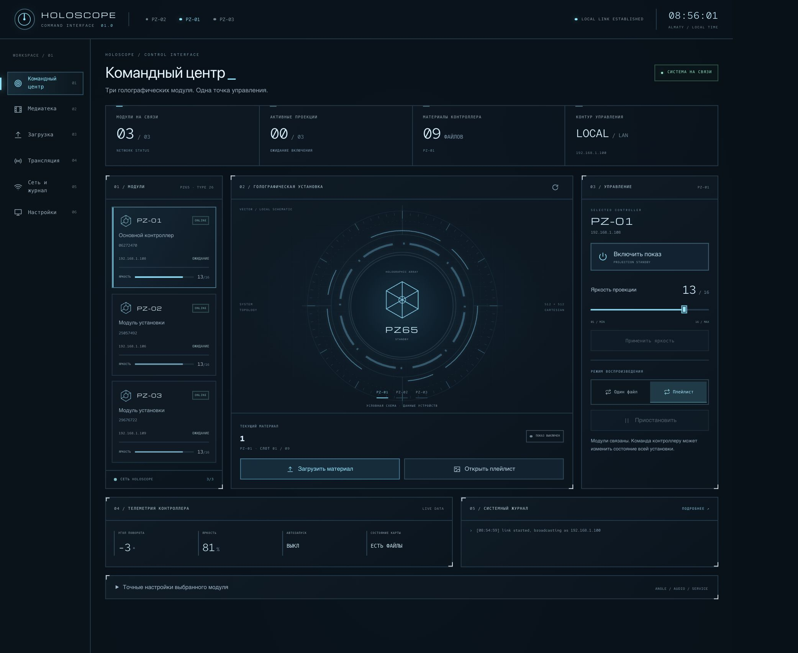

# HOLOSCOPE Command Center

Локальный командный центр для нашей установки из трёх голографических вентиляторов PZ65. React/TypeScript + Rust, русская локализация, управление питанием и воспроизведением, медиатека и телеметрия.



Это адаптация [trackerr/p56-studio](https://github.com/trackerr/p56-studio), исходный commit `dcc7d181b0766943f2df3efecd3f9c43d13c1706`. Лицензия MIT и атрибуция сохранены. [Оригинальный README](README-UPSTREAM.md), [особенности нашей PZ65-адаптации](README-PZ65.md).

## Начать на другом компьютере

Понадобятся Git, Node.js 24+, pnpm 11.25.0, Rust stable и Python 3.10+. На Windows для Rust также нужны C++ Build Tools. Для редактирования только интерфейса Rust не нужен.

```sh
git clone https://github.com/rasulcl13-boop/holoscope-command-center.git
cd holoscope-command-center
```

Репозиторий приватный: используй GitHub-аккаунт с доступом. Перед клонированием через GitHub CLI можно выполнить `gh auth login` и `gh auth setup-git`.

## Редактировать интерфейс

```sh
cd app/ui
pnpm install --frozen-lockfile
pnpm dev
```

Открой http://localhost:1420/ . Без Rust-сервера это встроенная демонстрация с виртуальным устройством; она не управляет реальными вентиляторами и не воспроизводит полную топологию трёх PZ65. Основные файлы:

- `app/ui/src/App.tsx` — оболочка и навигация.
- `app/ui/src/panels/CommandCenter.tsx` — главный экран и постоянные ID модулей.
- `app/ui/src/command.css` — оформление HUD и адаптивность.
- `app/ui/src/lib/i18n.tsx` — переводы.
- `crates/p56-service` и `crates/p56-core` — API и протокол.

## Собрать и запустить контроллер

Из корня репозитория:

```sh
python3 build.py
python3 launch.py --preview
```

На Windows используй `python` вместо `python3`. Скрипт собирает интерфейс в `app/src/index.html`, затем Rust-сервер в `bin/pz65-server` (`.exe` на Windows). Для release-сборки: `python3 build.py --release`.

Предпросмотр с виртуальным вентилятором: http://127.0.0.1:8766/ . Для реальной установки останови предпросмотр (Ctrl+C), подключись к сети HOLOSCOPE, закрой другой контроллер и запусти `python3 launch.py`. Рабочий адрес: http://127.0.0.1:8765/ . Запуск не включает питание автоматически. Один контроллер должен владеть TCP6666; одновременно запускать Holoscope или второй сервер нельзя.

Git переносит исходники. Чтобы управлять реальной установкой, компьютер с сервером должен иметь сетевую связь с вентиляторами. Не запускай второй контроллер для проверки только внешнего вида.

## Синхронизировать изменения

Перед началом работы:

```sh
git pull --ff-only
```

После правок интерфейса собери и закоммить исходники вместе с встроенным HTML:

```sh
cd app/ui
pnpm build
cd ../..
git add .
git commit -m "Update command center"
git push
```

На другом устройстве: `git pull --ff-only`, затем `python3 build.py`. Перезапуск работающего контроллера выполняется отдельно; push не меняет запущенный дэшборд.

Журналы, миниатюры, PID, локальные снимки состояния, зависимости и бинарники исключены из Git. Подробности аппаратной проверки, ограничения загрузки и Live cast описаны в [README-PZ65.md](README-PZ65.md).
